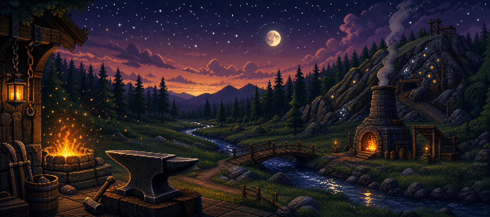

**A single-player action-RPG that lives in one HTML file.**
Chop, mine, fish, smelt and smith — no servers, no accounts, no signal.

`v0.3.2 — Gamma Gathering Fixes` · `100% offline` · `MIT licensed`

---

## 💖 Support this Project

[](https://buymeacoffee.com/djsaintg)

## What's new in v0.3.2

- **Gather from anywhere** — click a tree, rock or fishing spot from across
  the map and the hero walks over and gets straight to work (it used to
  arrive and just stand there)
- **Ore you can tell apart** — copper, tin, iron, coal and gold each have
  their own hand-drawn icon, coloured like their veins in the mine

## v0.3.1 — Visual Repairs

A repair pass on the Gamma overhaul:

- **No more flicker** — walking and chopping no longer strobe the lighting
  and nearby sprites
- **Clicks land true** — the tile under your cursor is the tile you get,
  anywhere on the map, and the hero stays dead centre at every zoom
- **No phantom swings** — felling a tree or emptying a rock ends the action
  the moment it falls
- **A livelier log** — the Adventurer's Log keeps updating even after it
  fills up

## The Gamma overhaul (v0.3.0)

The Gamma release is a ground-up visual pass over the whole valley, with the
gameplay of the combat beta fully folded in:

- **64-bit remastered renderer** — multi-tier swaying tree canopies,
  crystalline ore veins, mossy flagstones, animated water with sun glints,
  and a plank bridge with iron bolts. Flip back to the **8-bit legacy**
  engine any time from the Settings window.
- **A hero that actually walks** — a six-frame interpolated cycle with
  bending knees, counter-swinging arms and a bobbing torso; cows, hens and
  goblins got real gaits too.
- **Live fire lighting** — the furnace and campfire are true light sources,
  each casting a warm additive halo that pushes back the night.
- **Explorer camera** — mouse-wheel zoom from a 1.0× grand vista to a 3.2×
  close-up, with smooth sub-tile follow.
- **A valley with edges** — an impassable ring of snow-capped mountains now
  seals the realm; future updates simply push the ranges back to grow it.
- **Everything from the combat beta** — Grublin Gully, the chicken coop,
  loot drops, steak, feather-lure trout, bone-burying Prayer and more.

Full detail in [`CHANGELOG.md`](CHANGELOG.md). Planned work lives in
[`ROADMAP.md`](ROADMAP.md).

---

## Why this exists

Most of my working year is spent out of town — mine sites, back roads, places
where the phone bars go to die. ForgeBound is a classic-style browser RPG I'm
building to play in those dead zones: one that never phones home, never needs
an account, and compiles down to **a single HTML file** I can keep on a laptop
or a phone.

It's cut from the same cloth as the great browser MMOs of the 2000s — skilling,
XP curves, banks and bartering — rebuilt as a quiet single-player world. Every
name, tile, icon and sound in here is original and made from scratch.

## Quickstart

```bash
npm install        # once, while you still have signal
chmod +x launch.sh # once
./launch.sh        # builds if needed, then opens the game in your browser
```

| Command                | What it does                                                            |
| ---------------------- | ----------------------------------------------------------------------- |
| `./launch.sh`          | Verifies the project tree, builds if `dist/` is missing, opens the game |
| `./launch.sh --serve`  | Serves the game at `http://localhost:4173` (zero-dependency) and opens it |
| `./launch.sh --rebuild`| Forces a fresh build before launching                                   |
| `./launch.sh --help`   | Usage                                                                   |

Prefer the plain tools? `npm run dev` for a dev server, `npm run build` to
produce the single-file game, `npm run preview` to serve the build.

## Taking it offline

The build inlines _everything_ — code, styles, fonts — into one file:
`dist/index.html`. Once it exists, the internet is optional forever.

| Bring                            | Needed for                                     |
| -------------------------------- | ---------------------------------------------- |
| `dist/index.html`                | Playing — that one file **is** the whole game  |
| `launch.sh`                      | Convenient launching / local serving           |
| `src/` + configs + `node_modules/` | Rebuilding while off the grid                |

Open `dist/index.html` directly (double-click or `file://`) or use
`launch.sh --serve`. Progress autosaves to the browser's local storage — same
machine, same browser, pick up where you left off.

## The world

| Region            | What's there                                                                 |
| ----------------- | ---------------------------------------------------------------------------- |
| **Vale Square**   | The heart of it: furnace, anvil, campfire, bank booth, and Roka's trading post |
| **The Westwood**  | Trees and oaks — your first XP                                               |
| **Keldrek Mine**  | Copper, tin, iron, coal… and gold, if you're good enough                     |
| **The River**     | Shrimp in the western shallows, trout in the eastern current (bring a rod and feathers) |
| **The Pasture**   | Cows — with opinions, raw beef, and bones                                    |
| **The Coop**      | Four hens south-east of the square: feathers, raw chicken, and eggs they lay |
| **Grublin Gully** | A goblin camp north-east through the pasture — two Bramble Brigands lurk in the deep |
| **The Peaks**     | An impassable ring of snow-capped mountains sealing the valley; the bridge is the only crossing |

Old Maro stands in the square and knows this realm well — talk to him often.

## Skills

Ten skills are live, all running on the authentic-feeling XP curve
(83 XP to level 2, 13,034,431 to level 99):

| Skill           | Source                                            | Notes                          |
| --------------- | ------------------------------------------------- | ------------------------------ |
| Attack ⚔        | Melee combat in Grublin Gully                     | Improves accuracy              |
| Strength 👊     | Melee combat                                      | Raises your max hit            |
| Defence 🛡      | Being hit in combat                               | Harder for foes to land on you |
| Constitution ♥  | Dealing and taking damage                         | Your hitpoints                 |
| Prayer ✦        | Burying bones dropped by the fallen               | Big bones pay best             |
| Woodcutting 🪓  | Trees and oaks in the Westwood                    | —                              |
| Mining ⛏        | Copper/tin at 1, iron at 10, coal at 20, gold at 40 | —                            |
| Fishing 🐟      | Shrimp by hand; trout at the eastern current      | Trout: level 20 + rod + feather|
| Smithing 🔨     | Smelt bars at the furnace, forge blades at the anvil | Steel: level 30             |
| Cooking 🍳      | Cook catch, meat and eggs at the campfire         | Steak: level 15, heals 9       |

The full 23-skill grid is already stubbed in the UI — the rest light up as
quests and deeper systems arrive.

## How to play

| Do this                                     | To…                                              |
| ------------------------------------------- | ------------------------------------------------ |
| Left-click the ground                       | Walk (pathfinding handles the rest)              |
| Mouse-wheel over the world                  | Zoom the camera in and out                       |
| Left-click a tree, rock or fishing spot     | Gather — repeatedly, automatically               |
| Left-click a goblin or brigand              | Fight — auto-attacks until it falls              |
| Left-click a cow or chicken                 | Farm it — meat, bones and feathers               |
| Click loot on the ground                    | Pick it up — coins, blades, eggs and more        |
| Click an egg on the ground                  | Gather it — fry it at the campfire               |
| Click bones in your inventory               | Bury them for Prayer XP                          |
| Left-click furnace / anvil / campfire       | Open crafting, then pick a recipe                |
| Left-click the bank booth                   | Deposit and withdraw                             |
| Left-click Roka                             | Buy tools, sell your haul                        |
| Click food in your inventory                | Eat it (+HP)                                     |
| Click a tool in your inventory              | Wield it — better tiers work faster              |
| Right-click an inventory slot               | Drop it                                          |
| Gear button in the side panel               | Engine settings — zoom, render mode, audio       |
| `Esc`                                       | Close any panel                                  |

## Under the hood

- **React 19 + TypeScript**, built with **Vite 7** and **Tailwind v4**
- `vite-plugin-singlefile` collapses the entire game into one portable HTML file
- All in-game art is **drawn procedurally on `<canvas>`** — zero image assets
- Two render engines in one: the **64-bit remaster** and the **8-bit legacy**
  mode, switchable live from Settings
- **Lighting pass** — additive fire haloes over a day/night wash, plus
  interpolated six-frame character animation
- All sound is **synthesized with WebAudio** — zero audio assets
- BFS pathfinding, table-driven loot, resource respawns, wandering livestock,
  mountain-sealed world bounds
- Autosave to `localStorage`, debounced plus on-exit

```
ForgeBound/
├── launch.sh            # offline launcher (preflight, build, open/serve)
├── CHANGELOG.md         # release history (Keep a Changelog format)
├── ROADMAP.md           # planned work for upcoming versions
├── src/
│   ├── game/            # the engine
│   │   ├── map.ts       #   procedural tile world + mountain bounds
│   │   ├── data.ts      #   items, resources, recipes, loot, shop stock
│   │   ├── useGame.ts   #   the tick loop — actions, combat, economy, saves
│   │   ├── pathfinding.ts
│   │   ├── render.ts    #   dual-mode canvas renderer + lighting
│   │   ├── xp.ts        #   the XP curve + skill table
│   │   ├── audio.ts     #   WebAudio synth
│   │   └── types.ts
│   └── components/      # login, HUD, panels, modals, event log
└── dist/index.html      # ← the game, after one build
```

**Good places to start extending:** new items, resources and recipes live in
`src/game/data.ts`; new terrain in `src/game/map.ts` (push the mountains back
to grow the world); new gameplay loops in the tick inside `src/game/useGame.ts`.

**Cutting a release:** bump `"version"` in `package.json` (the page title,
login screen and log pick it up on build), move the changelog's notes under a
new version heading, then tag it — `git tag -a v0.3.1 -m "..."`.

## Roadmap

- [x] Combat v1 — melee, hitsplats, loot, death/respawn and Prayer
- [x] Pasture & coop — livestock, eggs, steak, feather-lure trout
- [x] Gamma v0.3.0 — remastered renderer, walk cycle, fire lighting, mountains, camera
- [x] v0.3.1 — visual repairs: canvas flicker, camera jitter and click targeting
- [x] v0.3.2 — gathering fixes: gather from any distance, distinct ore icons
- [ ] v0.3.3 — login flow rework + changelog-driven builder's notes, resizable windows
- [ ] Quests with real rewards
- [ ] Light up the remaining 13 skills
- [ ] A bigger world — push the Peaks back, new country beyond
- [ ] An original soundtrack
- [ ] Deeper crafting chains (fletching, crafting, leather)

## Legal note

ForgeBound is a personal, non-commercial project inspired by the classic
browser MMOs of the 2000s. It is **not affiliated with, endorsed by, or
connected to Jagex**, and no copyrighted assets are used — everything here
(names, art, icons, sound) is original.

## License

[MIT](LICENSE) — take it, learn from it, forge something of your own.
